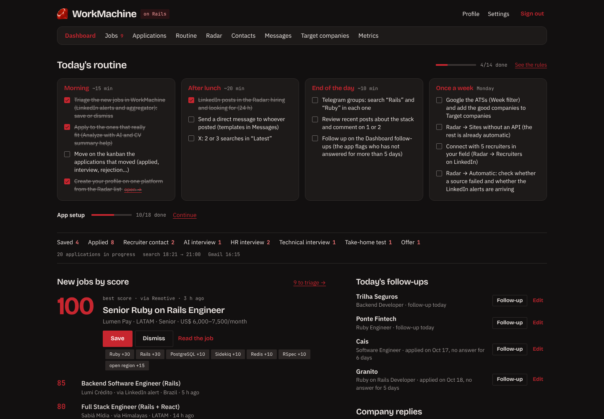
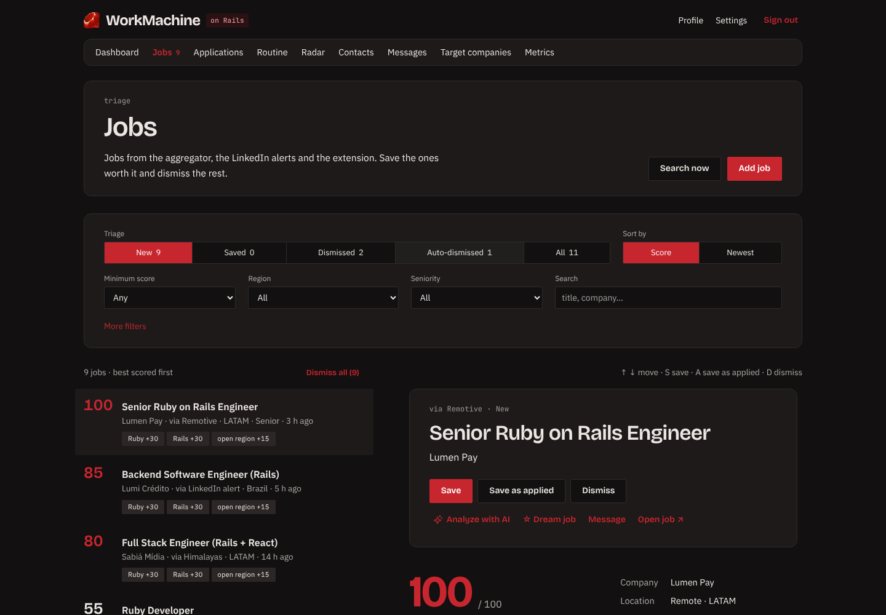
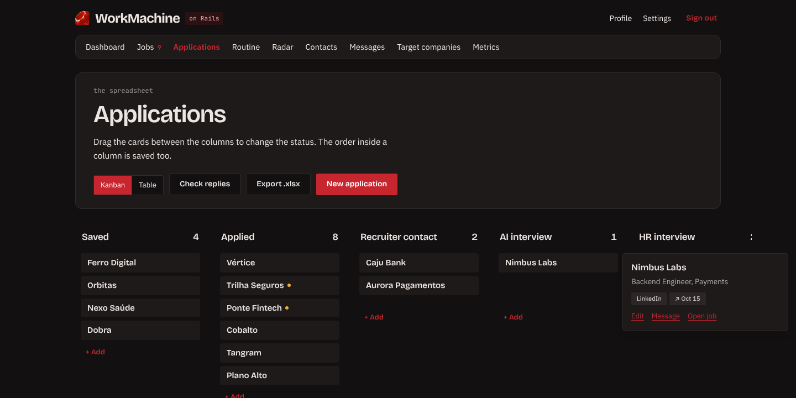
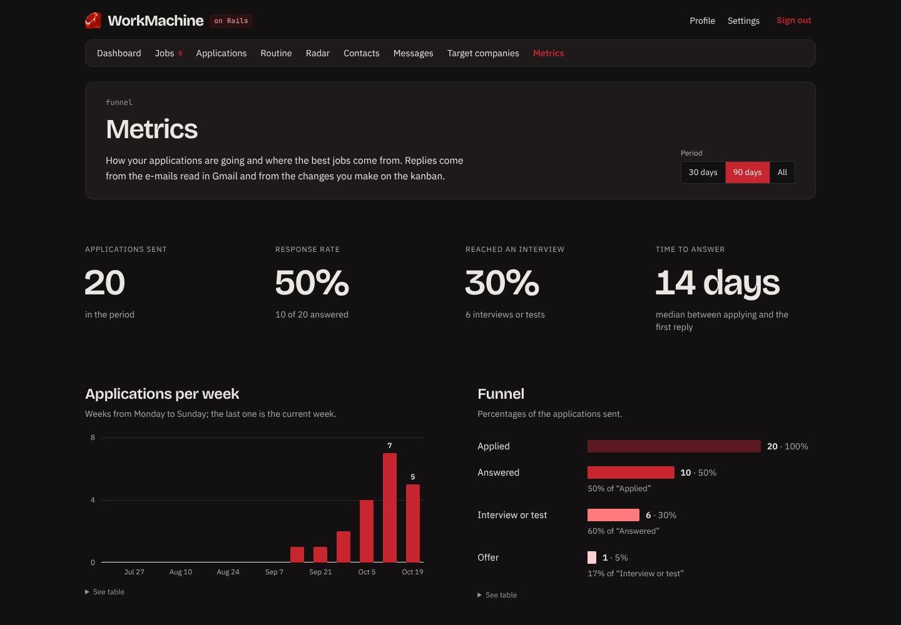
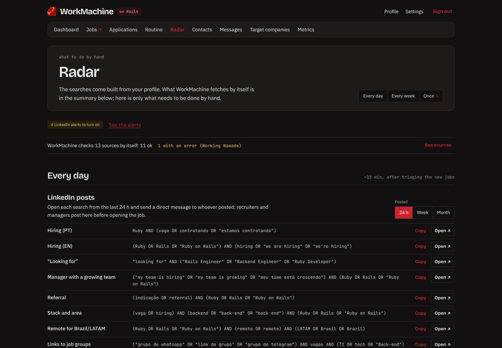
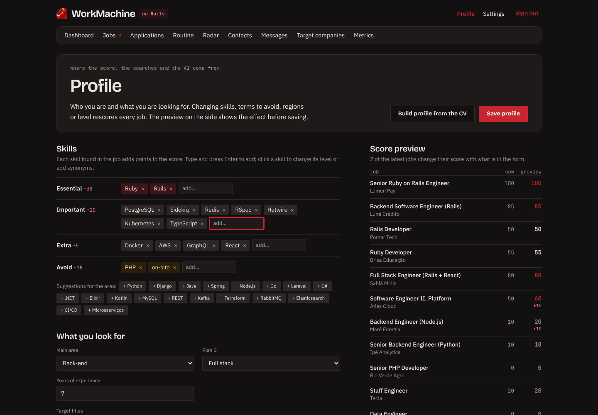
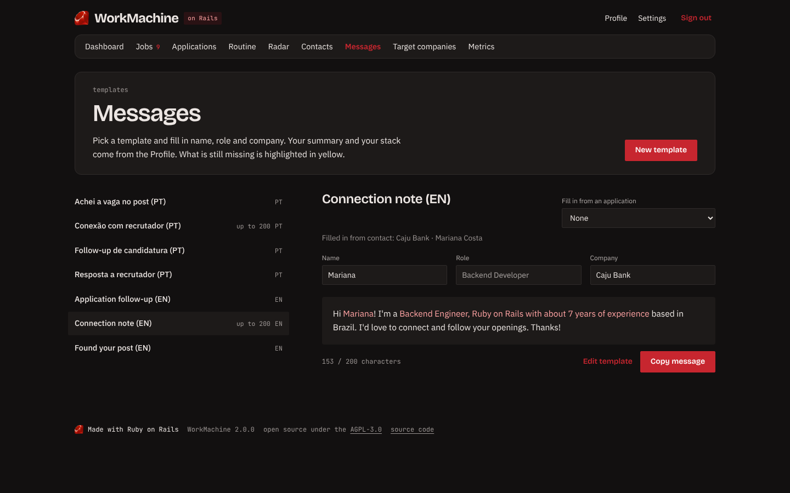
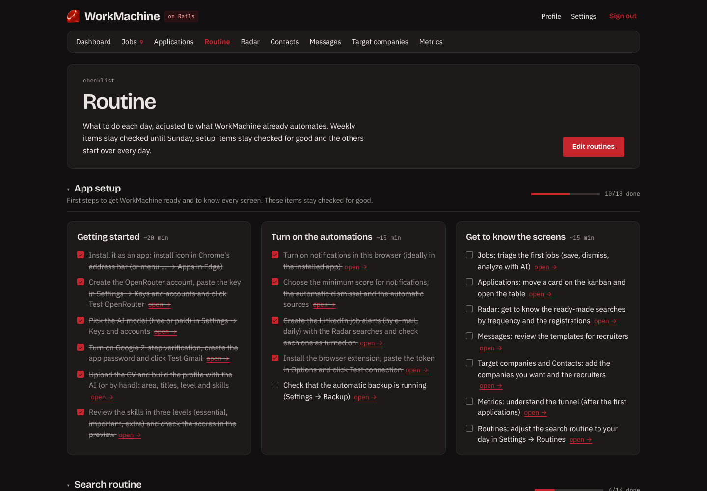
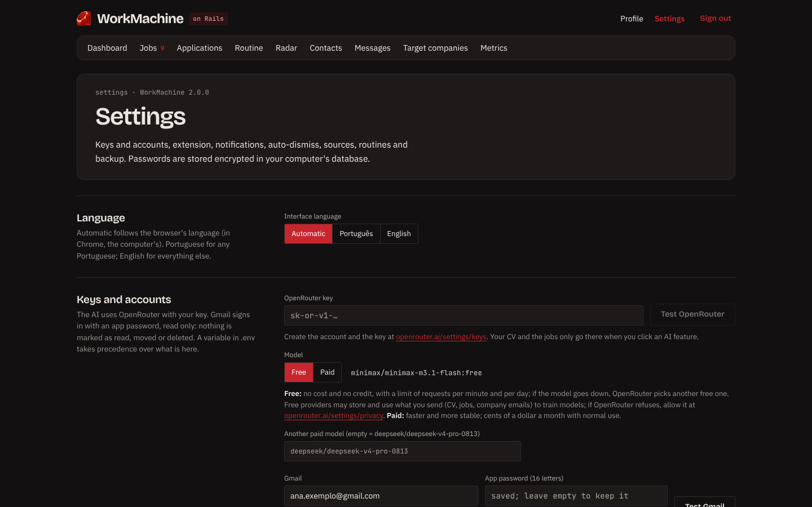

<div align="center">

**English** · [Português (Brasil)](README.pt-BR.md)


# WorkMachine

### Your tech job search on autopilot, running on your own computer.

Pulls jobs from 10+ sources, scores each one against **your** profile, tracks your applications on a
kanban board, reads the companies' replies in your Gmail and uses AI to analyze jobs and write messages.
**Free, open source and 100% local**: your data never leaves your machine.

[](https://github.com/will-terra/WorkMachine/stargazers)
[](https://github.com/will-terra/WorkMachine/actions/workflows/ci.yml)
[](LICENSE)
[](https://rubyonrails.org)
[](https://chromewebstore.google.com/detail/lohldenjhfbijbcolpglchnnionlbfaa)

**[Install in 5 minutes](#install)** · **[See the screens](#screen-tour)** · **[Leave a ⭐](https://github.com/will-terra/WorkMachine/stargazers)**

<br>



</div>

> [!TIP]
> **Like the idea?** Give the repository a ⭐: it's what gets the project to more people who are looking
> for a job, and it takes two seconds. Click **Star** at the top of this page.

## Why WorkMachine

Looking for a tech job has become a second job: ten tabs of job boards, LinkedIn alerts flooding your
inbox, a spreadsheet nobody updates and the feeling of sending your CV into the void. WorkMachine puts
it all in one place and does the boring part for you.

| | |
| - | - |
| 🎯 **A 0 to 100 score for every job** | Based on your skills (essential +30, important +10, extra +5), level, region and terms to avoid. You open the app and see the best ones first, with the math explained. |
| 🔎 **10+ sources, on its own** | Remotive, Remote OK, We Work Remotely, Himalayas, Remotar, Gupy, Programathor, Vagas.com, Hacker News, Greenhouse, Lever, Ashby and Workable boards and your LinkedIn alerts. Every 3 hours, without you opening anything. |
| 📬 **Reads the companies' replies** | Through your Gmail (read only), the AI recognizes rejections, interviews, AI interviews, take-home tests and offers and moves the card on the board. You get a notification. |
| 🤖 **AI that doesn't make things up** | Builds your profile from your CV, analyzes your fit with each job, tailors your CV summary and writes messages to recruiters. Uses a free model by default. |
| 🗂️ **Kanban + spreadsheet** | Drag applications between stages, export to `.xlsx` and keep track of overdue follow-ups. |
| 📈 **Funnel metrics** | Reply rate, interview rate, time to answer and which origins and sources really pay off. |
| 🧭 **Radar and routine** | Ready-made searches for LinkedIn, X, Google and groups (built from your profile) and an editable daily routine, with a step-by-step setup of the app. |
| 🌎 **English and Portuguese** | The interface follows your browser's language (Portuguese for pt-BR and pt-PT, English for everything else), and you can pick one in Settings. The extension too. |
| 🔒 **Real privacy** | Runs on your computer with Docker. No account, no server, no tracking. Install it as an app (PWA) and use it like any program. |

> WorkMachine **does not scrape LinkedIn and does not apply on its own**: that breaks LinkedIn's terms
> and puts your account at risk. Job alerts arrive through your Gmail, and the browser extension only
> reads a page when you click it.

## Screen tour

### Jobs: triage with a score and the reason for it
List and detail side by side. Every job shows where its score came from (Ruby +30, open region +15…).
Keyboard shortcuts (`S` saves, `A` saves as applied, `D` dismisses) and **Undo** for everything. One click
on **Analyze with AI** compares the job with your profile.



### Applications: the kanban that updates itself
From saved job to offer, including an **AI interview** column for recorded video or audio interviews.
Each column scrolls on its own; hover over a card to see the job, origin, dates and shortcuts. The yellow
dot means the follow-up is due.



### Metrics: know what's working
Applications per week, the funnel from applied to offer and the rates by origin. Stop spending energy
where it doesn't pay off.



### Radar: what to do by hand, ready to go
The right searches for LinkedIn (posts and people), X, Google and Telegram groups, built from your skills
and titles. Copy or open them with one click. It also lists the LinkedIn job alerts to turn on, with a box for
the ones you already did; when your profile changes, the new alerts show up there. And it shows whether an
automatic source failed.



### Profile: change a skill and see the effect right away
Skills in three levels, terms to avoid, regions and level. The **score preview** on the side recalculates
the latest jobs while you edit, before you save. Upload your CV and let the AI build the draft.



### Messages and Routine
Message templates for recruiters that fill themselves in with the contact, the job and your profile (with
a character counter for LinkedIn's connection note). And a daily and weekly routine you edit in Settings,
to stay consistent without thinking about it.

<p>
  
  
</p>

### Settings
Language, AI and Gmail keys (encrypted on your computer), browser extension, notifications, auto-dismiss,
sources, routines and automatic database backup.



<div align="center">

**Could this help someone you know?** Send the link to anyone looking for a tech job and
[⭐ star the project](https://github.com/will-terra/WorkMachine/stargazers) so more people can find it.

</div>

## What you need

- A computer with **Windows 10/11, macOS or Linux** and about 2 GB free.
- **Docker Desktop** (on Linux, Docker Engine with the Compose plugin).
- Optional, for the AI: a free [OpenRouter](https://openrouter.ai) account. The default is a free model,
  which needs no credit. If you prefer the paid model (DeepSeek V4 Pro), a few dollars of credit last
  for months: building your profile from your CV costs less than 1 cent.
- Optional, for the LinkedIn alerts and the companies' replies: a Gmail account with 2-step verification
  turned on.

## Install

1. **Install Docker Desktop** from [docker.com/products/docker-desktop](https://www.docker.com/products/docker-desktop/)
   and open it once. On Windows it turns on WSL2 by itself (it may ask you to restart).
2. **Download WorkMachine.** With git:
   ```bash
   git clone https://github.com/will-terra/WorkMachine.git
   cd WorkMachine
   ```
   Without git: on the project's GitHub page, click **Code → Download ZIP**, unzip it and open a terminal
   in the folder (on Windows, right-click the folder → **Open in Terminal**).
3. **Start the app:**
   ```bash
   docker compose up -d
   ```
   The first time, it downloads the WorkMachine image (a few minutes). From then on, the app starts by
   itself together with Docker.
4. Open **http://localhost:3000**, create your account (it only exists on your computer) and follow the
   **First run**: AI key, Gmail, profile and the first job search.

### Install as an app

With the app open in Chrome or Edge: install icon in the address bar (Chrome) or `…` menu → **Apps** →
**Install this site as an app** (Edge). It gets its own icon and window; Docker still needs to be running.

## First steps

The app opens with the **App setup** routine: a step-by-step list with a link to each screen. In short:

1. **Profile.** Upload your CV (PDF, DOCX or TXT) and click **Build profile from the CV**: the AI fills
   in a draft that you review before saving. Adjust the area, the target titles, the level and the skills
   in three levels. The preview on the side shows how the scores turn out. Without AI, fill it in by
   hand: the screen suggests titles and skills for your area.
2. **Jobs.** Every 3 hours the aggregator searches with your profile's terms. In the triage, save the
   good ones (they become applications) and dismiss the rest.
3. **Applications.** Move the cards on the board. With Gmail connected, the companies' replies
   (rejection, interview, test, offer) move the cards by themselves. Invitations to asynchronous
   interviews (recorded video or audio, AI interviews such as HireVue and Willo) go to the
   **AI interview** column.
4. **Radar.** What to do by hand, by frequency, with the searches already built for your profile. Create
   your LinkedIn job alerts from the searches in the **LinkedIn alerts** section and check each one as
   turned on: when the profile changes, the new alerts show up there.

| Screen | What it's for |
| - | - |
| **Dashboard** | Today's routine, new jobs by score, today's follow-ups and the companies' replies. |
| **Jobs** | Triage with filters and sorting: save, save as applied, dismiss, analyze with AI, mark as a dream job. |
| **Applications** | Kanban and table, the company's e-mails in each application, `.xlsx` and CSV export. |
| **Routine** | Daily and weekly checklist and the step-by-step app setup. Routines are edited in **Settings → Routines**. |
| **Radar** | What to do by hand: LinkedIn alerts to turn on, LinkedIn posts and people, X, Google, Telegram groups, sites without an API and sign-ups. |
| **Contacts** and **Target companies** | Recruiters and hiring managers; companies whose job boards the aggregator reads. |
| **Messages** | Message templates filled in with the job, the contact and your profile. |
| **Metrics** | Applications per week, funnel, reply and interview rates by origin and the sources that pay off most. |
| **Profile** | Who you are and what you're looking for: the score, the searches, the Radar and the AI come from it. |
| **Settings** | Language, keys and accounts, extension, notifications, auto-dismiss, sources, routines and backup. |

The automatic sources: Remotive, Remote OK, We Work Remotely, Working Nomads, Himalayas, Remotar, Gupy,
Programathor, Vagas.com, Telegram channels (for junior profiles), backend-br and frontendbr (GitHub),
Hacker News "Who is hiring", GoRails Jobs and the Greenhouse, Lever, Ashby and Workable boards of your
target companies. The niche ones only run when they match your profile, and each one can be turned off
in Settings. Every source respects the limits and the credits its API asks for, and what each site's
robots.txt allows.

## AI (OpenRouter)

1. Create an account at [openrouter.ai](https://openrouter.ai).
2. Create a key at [Settings → Keys](https://openrouter.ai/settings/keys) and paste it in **Settings →
   Keys and accounts** (or in the First run). Use **Test OpenRouter** to check it.
3. Choose the model in **Settings → Keys and accounts → Model**:

| | Free (default) | Paid |
| - | - | - |
| Model | MiniMax M3.1 Flash (`minimax/minimax-m3.1-flash:free`); if it's down or at its limit, OpenRouter picks another free model (`openrouter/free`) | DeepSeek V4 Pro (`deepseek/deepseek-v4-pro-0813`), or any other OpenRouter model you type in |
| Cost | None; no credit needed | Cents of a dollar a month with normal use; needs credits at [Settings → Credits](https://openrouter.ai/settings/credits) |
| Limits | OpenRouter limits free requests per minute and per day (the daily limit goes up once you have bought credits). When you go over, the AI tells you and works again later | No tight limit |
| Your data | The providers of the free models may store and use what you send (CV, jobs, company e-mails) to train models | Each provider's policy applies, which you see and control at [Settings → Privacy](https://openrouter.ai/settings/privacy) |

If OpenRouter refuses the free models because of your data policy, allow them at
[Settings → Privacy](https://openrouter.ai/settings/privacy) or switch to the paid model. The ids of the
free models change over time; that's why the app has `openrouter/free` as a fallback.

The AI only runs when you click: building the profile, analyzing the fit, tailoring the CV summary or
writing a message. The exception is reading the companies' replies in Gmail, which runs on its own. On
the paid model, the button shows the estimated cost beforehand, and every result keeps its real cost.
The AI only uses the facts in your profile and never invents experience.

## Gmail (LinkedIn alerts and company replies)

WorkMachine signs in to Gmail with an **app password**: a 16-letter password, separate from your account
password, that Google creates for a single program. Your regular account password doesn't work.

1. Turn on **2-Step Verification** for your Google account: at
   [myaccount.google.com/security](https://myaccount.google.com/security), **2-Step Verification** →
   **Turn on**. Without it, Google doesn't offer app passwords.
2. Open [myaccount.google.com/apppasswords](https://myaccount.google.com/apppasswords) (Google may ask
   for your password again), type the name "WorkMachine" and click **Create**.
3. Copy the 16 letters that show up. They are shown only once; if you lose them, delete that password
   and create another one. The spaces between the blocks don't matter.
4. In **Settings → Keys and accounts**, enter the e-mail and the app password and click **Test Gmail**.
5. On LinkedIn, create your job alerts (by e-mail, daily) from the Radar's searches (**Once → LinkedIn
   alerts**) and check each one as turned on.

WorkMachine opens the mailbox read only: nothing is marked as read, moved or deleted. Every hour it
imports the LinkedIn alerts and looks for the replies from the companies you applied to. The first time,
it looks at the alerts from the last 14 days and the replies from the last 30.

Common problems:

- **The app passwords page says the option isn't available:** 2-Step Verification is off, the account
  belongs to work or school (the administrator may have blocked it) or the account uses Google's
  Advanced Protection. In the last two cases, use another Gmail account to receive the alerts.
- **"Test Gmail" says Google requires an app password:** the regular account password was used. Create
  the app password and paste the 16 letters.
- **The LinkedIn alerts don't reach the app:** if a Gmail filter takes the alerts out of the inbox,
  WorkMachine doesn't see them. Remove the filter, or make the app read every e-mail with the line
  `GMAIL_MAILBOX=[Gmail]/All Mail` in `.env` (`[Gmail]/Todos os e-mails` if your Gmail is in Portuguese);
  then run `docker compose up -d`.
- **To cut access:** delete the "WorkMachine" password at
  [myaccount.google.com/apppasswords](https://myaccount.google.com/apppasswords). Your account password
  doesn't change, and the app stops reading the mailbox right away.

## Browser extension

It saves the job open in any site (LinkedIn, Greenhouse, Lever, Gupy, career pages…) to WorkMachine,
shows on its icon the score of the LinkedIn jobs already in the app and saves recruiters to Contacts.

1. Install it from the **[Chrome Web Store](https://chromewebstore.google.com/detail/lohldenjhfbijbcolpglchnnionlbfaa)**. It works in Chrome and in Edge (in Edge,
   allow extensions from other stores when it asks).
2. In **Settings → Browser extension**, click **Generate token** and copy it.
3. Pin the icon to the toolbar, open the extension's **Options**, paste the token and click
   **Test connection**.

That's it: the store keeps the extension up to date by itself.

## Notifications

In **Settings**, click **Turn on notifications** (preferably inside the installed app). You get alerts
for new jobs with a high score (default 40), for the companies' replies and, at 8 a.m., for the day's
follow-ups. Each kind can be turned off.

## Backup and data

Everything lives in Docker's `storage` volume: the database, your CV and the keys that encrypt the
passwords.

- **Automatic backup:** every hour the database is copied to the `backups` folder inside the WorkMachine
  folder. The copies from the last 24 hours and one a day from the last 14 days are kept. To save them
  in another folder (one that already syncs to the cloud, for example), create a `.env` file in the
  WorkMachine folder with the line `WORKMACHINE_BACKUP_DIR=` and the folder's path (examples in
  [DEVELOPMENT.md](DEVELOPMENT.md#variáveis-de-ambiente)); then run `docker compose up -d`.
- **Spreadsheet:** Applications → Export .xlsx or Export CSV.
- **Restore a backup** (change the file name):
  ```bash
  docker compose stop web
  docker compose run --rm --no-deps --entrypoint sh web -c \
    'cp backups/workmachine-YYYY-MM-DD-HHMM.sqlite3 storage/production.sqlite3 && rm -f storage/production.sqlite3-wal storage/production.sqlite3-shm'
  docker compose start web
  ```
  The passwords saved in Settings only open with the `storage/workmachine-secrets.yml` file of the same
  volume. On a new volume, enter the keys again in Settings.
- **Delete everything:** `docker compose down -v` removes the app and the volume with the data. The
  backups stay.

## Update

```bash
docker compose pull && docker compose up -d
```

The database is updated by itself on start, and the Chrome Web Store updates the extension.

## Troubleshooting

- **Port 3000 is already in use:** change `127.0.0.1:3000:3000` to `127.0.0.1:3001:3000` in
  `docker-compose.yml` and open http://localhost:3001 (change the address in the extension's Options too).
- **I forgot my password:**
  ```bash
  docker compose exec web bin/rails runner 'User.first.update!(password: "a-new-password")'
  ```
- **See what's going on:** `docker compose logs -f web`.
- **Search for jobs now:** **Search now** button in Jobs.

## Privacy

WorkMachine runs only on your computer and sends no data to the author or to any server. All that leaves
it: the requests to the public job sources; the read-only connection to your Gmail, if turned on; and,
when you use an AI feature, the text it needs (CV, profile, job or company e-mail) to OpenRouter, with
your key. Passwords are stored encrypted in the local database. The full policy, including what the
browser extension reads, is in [PRIVACY.md](PRIVACY.md#privacy-policy).

## License and contributing

Open source under the [GNU AGPL-3.0](LICENSE): you can use, study, change and share it; whoever shares or
offers over a network a modified version must publish its code under the same license.

Found a problem or have a suggestion? Open an issue. Want to work on the code? See
[CONTRIBUTING.md](CONTRIBUTING.md) and [DEVELOPMENT.md](DEVELOPMENT.md) (in Portuguese). The screenshots
in this README use fictional data and are made with `script/readme/`, in English and in Portuguese
(instructions at the top of each file).

---

<div align="center">

### Did WorkMachine help you?

A ⭐ is the simplest way to say thanks and to get the project to people who are looking for a job.

**[⭐ Star it on GitHub](https://github.com/will-terra/WorkMachine/stargazers)**

Made with Ruby on Rails, for people on the other side of the hiring process.

</div>
