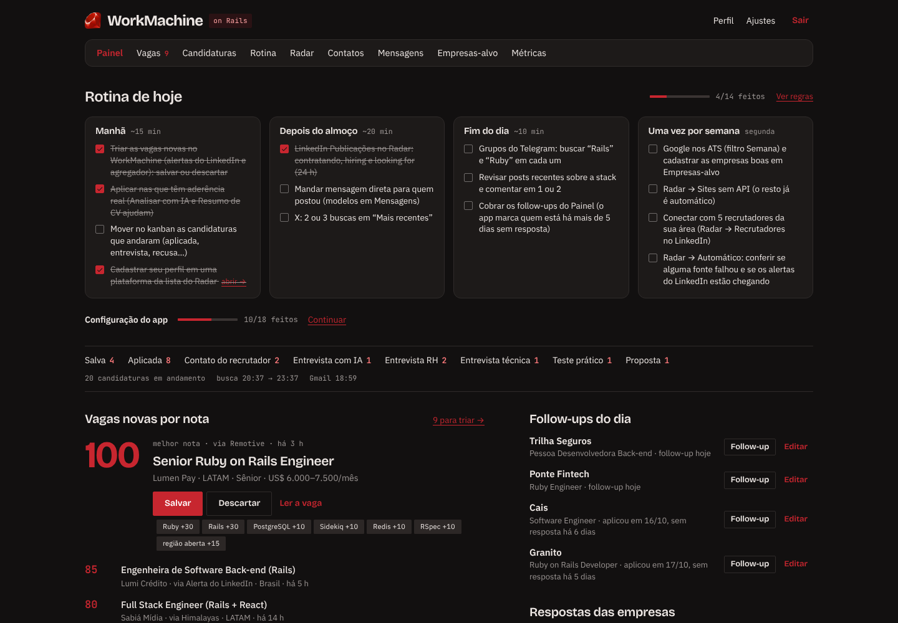
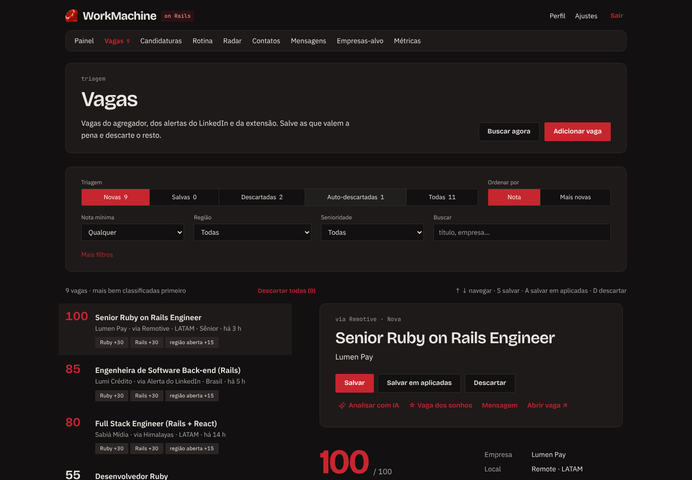
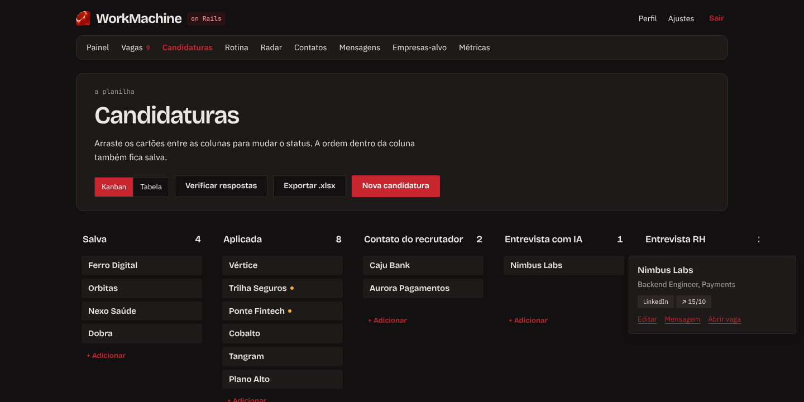
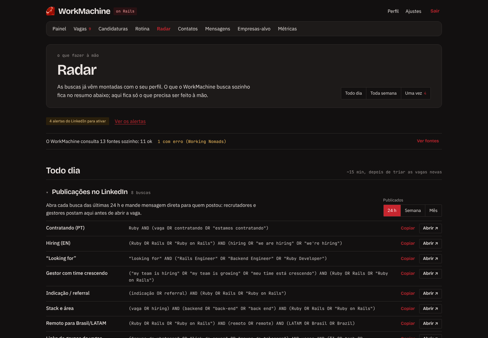
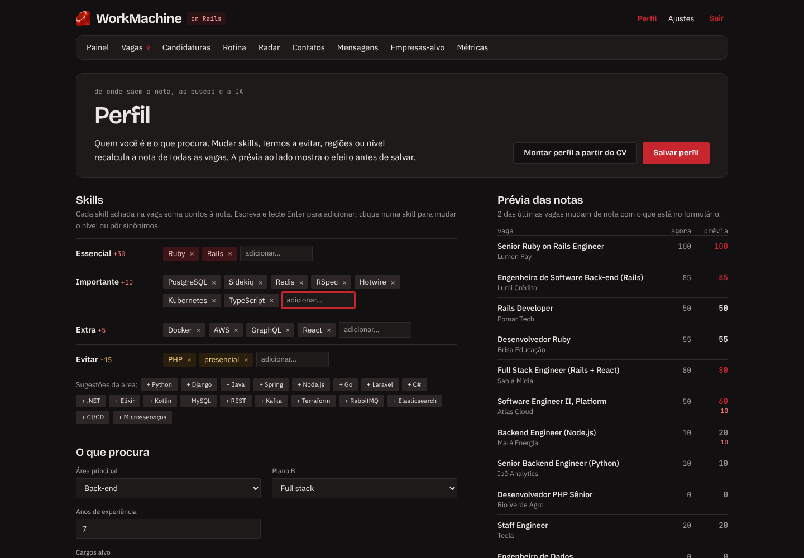
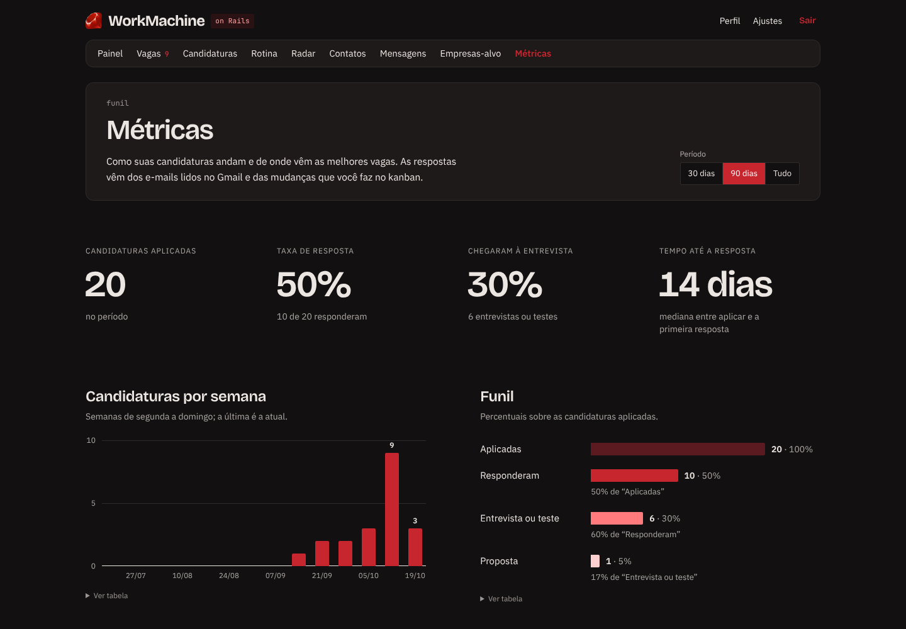
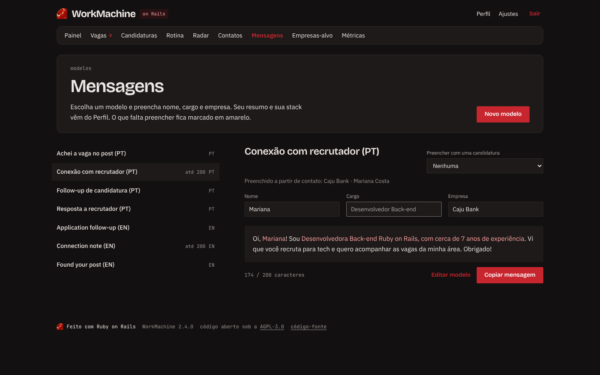
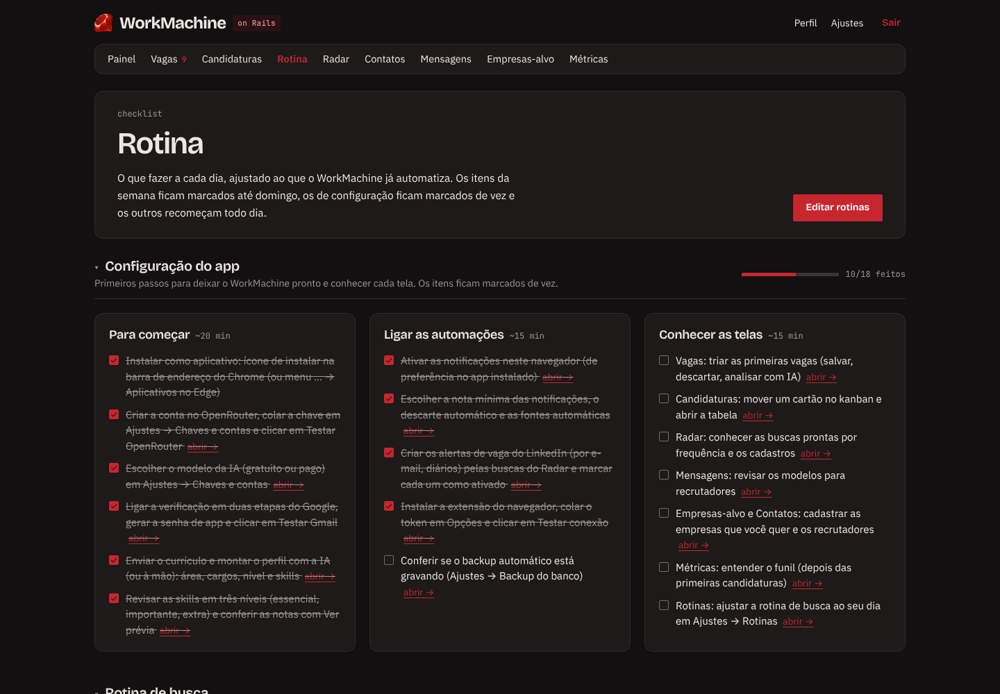
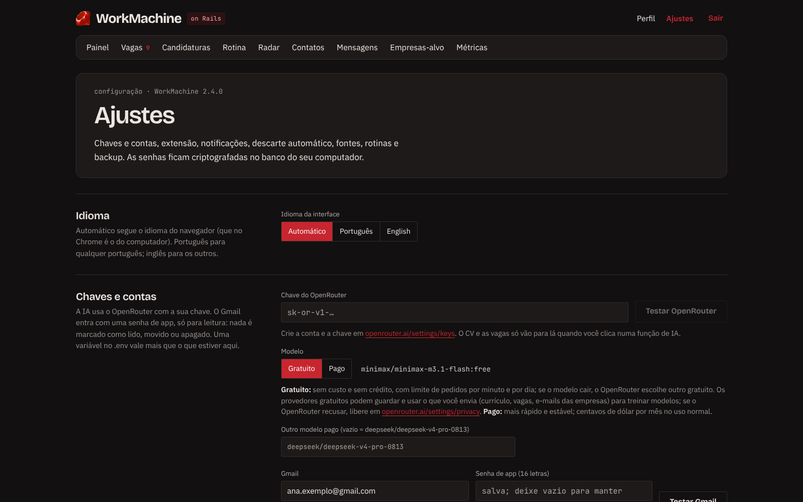

<div align="center">

[English](README.md) · **Português (Brasil)**


# WorkMachine

### Sua busca de emprego em tech no piloto automático, rodando no seu computador.

Junta vagas de mais de 10 fontes, dá nota para cada uma pelo **seu** perfil, controla as candidaturas
num kanban, lê as respostas das empresas no seu Gmail e usa IA para analisar vagas e escrever mensagens.
**Grátis, código aberto e 100% local**: seus dados nunca saem da sua máquina.

[](https://github.com/will-terra/WorkMachine/stargazers)
[](https://github.com/will-terra/WorkMachine/actions/workflows/ci.yml)
[](LICENSE)
[](https://rubyonrails.org)
[](https://chromewebstore.google.com/detail/lohldenjhfbijbcolpglchnnionlbfaa)

**[Instalar em 5 minutos](#instalar)** · **[Ver as telas](#tour-pelas-telas)** · **[Guia de uso](GUIDE.pt-BR.md)** · **[Deixar uma ⭐](https://github.com/will-terra/WorkMachine/stargazers)**

<br>



</div>

> [!TIP]
> **Gostou da ideia?** Dê uma ⭐ no repositório: é o que faz o projeto chegar em mais gente que está
> procurando emprego, e leva dois segundos.

## Por que o WorkMachine

Procurar emprego em tecnologia virou um segundo emprego. O WorkMachine junta tudo num lugar só e faz a
parte chata por você.

| | |
| - | - |
| 🎯 **Nota de 0 a 100 para cada vaga** | Pelas suas skills, nível, região e termos a evitar, com a conta explicada. As melhores aparecem primeiro. |
| 🔎 **Mais de 10 fontes, sozinho** | Remotive, Gupy, Himalayas, Remotar, Programathor, Hacker News, quadros Greenhouse e Lever, seus alertas do LinkedIn e outras. A cada 3 horas. |
| 📬 **Lê as respostas das empresas** | No seu Gmail, só leitura: recusa, entrevista, teste e proposta movem o cartão no kanban sozinhos. |
| 🤖 **IA que não inventa** | Monta o perfil pelo currículo, analisa o fit, adapta o CV e escreve mensagens. Usa um modelo gratuito por padrão. |
| 🧭 **Kanban, métricas, Radar e rotina** | Candidaturas da vaga salva à proposta, o funil que mostra o que rende, buscas prontas para o que é feito à mão e uma rotina diária. |
| 🔒 **No seu computador** | Roda via Docker, sem conta, servidor ou rastreamento. Em português e inglês, e instalável como app. |

> Sem scraping do LinkedIn e sem candidatura automática, que violam os termos e arriscam a conta: os
> alertas chegam pelo seu Gmail, e a extensão só lê uma página quando você clica nela.

## Tour pelas telas

**Vagas:** triagem com a nota explicada, atalhos de teclado e análise com IA em um clique.



**Candidaturas:** o kanban que se atualiza sozinho com as respostas das empresas.



**Radar:** as buscas do que é feito à mão, já montadas com o seu perfil, e os alertas do LinkedIn para ativar.



**Perfil:** mude uma skill e veja as notas mudarem antes de salvar.



**Métricas, Mensagens, Rotina e Ajustes:**

<p>
  
  
  
  
</p>

## Instalar

Você precisa de um computador com Windows 10/11, macOS ou Linux e do
[Docker Desktop](https://www.docker.com/products/docker-desktop/) (abra uma vez; no Windows ele ativa o
WSL2 sozinho).

```bash
git clone https://github.com/will-terra/WorkMachine.git
cd WorkMachine
docker compose up -d
```

Sem git: no GitHub, clique em **Code → Download ZIP**, descompacte e rode `docker compose up -d` na pasta.
Depois abra **http://localhost:3000**, crie a sua conta (ela só existe no seu computador) e siga o
**Primeiro uso**. Para usar como programa, instale pelo ícone da barra de endereço do Chrome ou do Edge.

## Primeiros passos

O app abre com um passo a passo de configuração. O essencial:

- **Perfil:** envie o currículo e deixe a IA montar o rascunho (com uma chave gratuita do
  [OpenRouter](GUIDE.pt-BR.md#ia-openrouter)), ou preencha à mão.
- **Gmail:** com uma [senha de app](GUIDE.pt-BR.md#gmail), o app lê os alertas do LinkedIn e as respostas
  das empresas.
- **Extensão:** instale pela [Chrome Web Store](https://chromewebstore.google.com/detail/lohldenjhfbijbcolpglchnnionlbfaa)
  e cole o token de **Ajustes**.
- **Radar:** crie os alertas de vaga do LinkedIn pela seção **Alertas do LinkedIn** e marque cada um.

Modelos de IA e custos, Gmail, extensão, notificações, backup e problemas comuns: veja o
**[guia de uso](GUIDE.pt-BR.md)**.

## Atualizar

```bash
docker compose pull && docker compose up -d
```

## Privacidade

O WorkMachine roda só no seu computador e não manda dados para o autor nem para servidor algum. Saem dele
apenas as buscas às fontes públicas de vagas, a leitura do seu Gmail (se ligada) e, quando você usa a IA,
o texto necessário para o OpenRouter, com a sua chave. Detalhes em [PRIVACY.md](PRIVACY.md).

## Licença e contribuição

Código aberto sob a [GNU AGPL-3.0](LICENSE). Achou um problema ou tem uma sugestão? Abra uma issue. Para
mexer no código, veja [CONTRIBUTING.md](CONTRIBUTING.md) e [DEVELOPMENT.md](DEVELOPMENT.md).

---

<div align="center">

### O WorkMachine te ajudou?

Uma ⭐ é a forma mais simples de agradecer e de fazer o projeto chegar em quem está procurando emprego.

**[⭐ Dar uma estrela no GitHub](https://github.com/will-terra/WorkMachine/stargazers)**

Feito com Ruby on Rails, para quem está do outro lado do processo seletivo.

</div>
